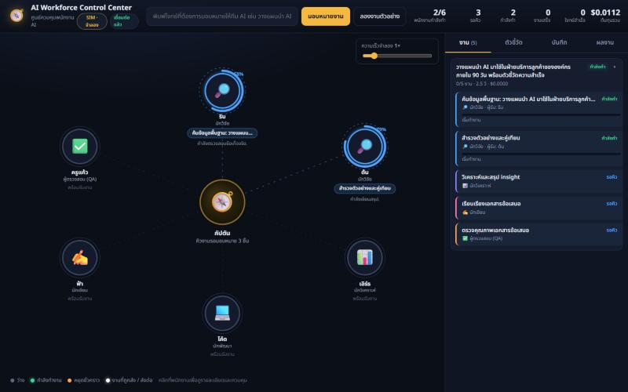
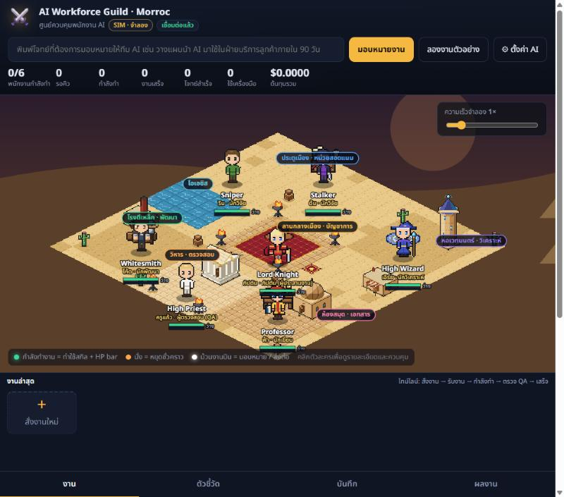

# AI Workforce Control Center — ศูนย์ควบคุมพนักงาน AI

ต้นแบบระบบ "องค์กรที่มี AI ทำงาน" ที่ได้แรงบันดาลใจจากสถาปัตยกรรม multi-agent ของ Grok (xAI):
กัปตัน (Project Manager) 1 คนรับโจทย์ แตกงาน มอบหมายให้ทีมผู้เชี่ยวชาญ 6 ตำแหน่ง (การตลาด, วิจัย, การเงิน/กลยุทธ์, วิศวกร AI, นักพัฒนา, QA & Compliance) ทำงานคู่ขนาน ส่งต่องานกันได้
มี QA ตรวจคุณภาพและส่งกลับแก้ และมี **หน้าเว็บเดียว** ที่เห็นทุกอย่างสด ๆ เป็นแอนิเมชัน พร้อมตัวชี้วัดและปุ่มควบคุม



## ธีมใหม่: ทีม AI ในร่างตัวละคร Ragnarok Hi-class บนเมืองมอร็อค



- แผนที่ไอโซเมตริกเมืองมอร็อค แบ่งโซนตามอาชีพ: Lord Knight (กัปตัน) ลานกลางเมือง · Sniper/Stalker (นักวิจัย) ประตูเมือง · High Wizard (วิเคราะห์) หอเวทมนตร์ · Professor (นักเขียน) ห้องสมุด · Whitesmith (นักพัฒนา) โรงตีเหล็ก · High Priest (QA) วิหาร
- ตัวละครเป็นพิกเซลอาร์ตต้นฉบับ (ไม่ใช้ไฟล์จากเกม) มีท่าใช้สกิลตอนทำงาน นั่งตอนพัก ป้ายชื่อ+HP/SP bar แบบ RO กล่องแชตบอกเฟส (ชื่อสกิลประจำอาชีพ) ม้วนงานบินเมื่อมอบหมาย/ส่งต่อ แสง Blessing เมื่อ QA ผ่าน และ LEVEL UP เมื่อโจทย์เสร็จ
- แผงรายชื่อทีมซ้าย (สถานะ · % · เสร็จวันนี้ · เครื่องมือ) การ์ดงานล่าสุดพร้อมไทม์ไลน์ 5 ขั้น และปุ่ม "⚙ ตั้งค่า AI" เลือกโมเดล/ความลึก/เครื่องมือต่อคน
- รายละเอียด: [docs/05-ragnarok-theme.md](docs/05-ragnarok-theme.md) (ตารางอาชีพ, สกิล, ลิขสิทธิ์) · [docs/04-scene-spec.md](docs/04-scene-spec.md) (engine ฉาก) · [docs/03-sprite-spec.md](docs/03-sprite-spec.md) (รูปแบบสไปรต์ + `tools/render-sprite.mjs`) · [docs/06-dashboard-layout.md](docs/06-dashboard-layout.md) (เลย์เอาต์)
- ทดสอบฉากเดี่ยว ๆ ได้ที่ `/scene-test.html`
- **ออฟฟิศ 3 มิติ:** ทีมเดียวกันในร่างคนจริงในออฟฟิศ (three.js + ตัวละคร Mixamo) ทุกการเคลื่อนไหวผูกกับเหตุการณ์จริง 1:1 (เดินรับงานจากกัปตัน นั่งพิมพ์/อ่านจอ/พิมพ์เร็วตามเครื่องมือที่ใช้ ส่งงาน แก้รอบที่ N เมื่อ QA ส่งกลับ กัปตันเข้าห้องประชุมตอนวางแผน ทีมดีใจเมื่อโจทย์เสร็จ) ไม่มีพฤติกรรมสุ่มระหว่างมีโจทย์ — กดปุ่ม **🏢 ออฟฟิศ 3D** มุมขวาบนของเวทีในแดชบอร์ดเพื่อสลับจากแผนที่มอร็อค (จำค่าที่เลือกไว้) แตะตัวละครเปิดรายละเอียด **แตะจอคอมของแต่ละคน** (หรือปุ่ม 🖥️ ใน drawer) เปิด "หน้าจอการทำงานจริง": ข้อความที่สตรีมสด เครื่องมือที่ใช้ (คำค้น/URL/คำสั่ง → ผล) ผลตรวจ QA และผลงาน; จอมอนิเตอร์บนโต๊ะก็แสดงสิ่งที่กำลังพิมพ์สด ๆ หรือเปิดหน้าเดี่ยวที่ `/office3d/index.html`
  ไฟล์โมเดล (`public/office3d/models/`) ไม่อยู่ใน git — คู่มือ + API + วิธีวาง/แปลงไฟล์: [docs/09-office3d.md](docs/09-office3d.md)

## สิ่งที่ทำได้

- **เห็นว่า AI แต่ละตัวกำลังทำอะไร** — ชื่องาน เฟสที่กำลังทำ % ความคืบหน้า และข้อความที่กำลังพิมพ์ (สด)
- **แอนิเมชันเรียลไทม์** — ก้อนงานวิ่งจากกัปตันไปหาพนักงาน วิ่งระหว่างพนักงานเมื่อส่งต่อ และวิ่งกลับเมื่อเสร็จ
- **ส่งต่องาน (handoff)** — อัตโนมัติเมื่อ QA ไม่ผ่าน หรือสั่งเองจากหน้าเว็บ (เลือกคนรับ + เหตุผล)
- **ควบคุมได้ในหน้าเดียว** — มอบหมายโจทย์, หยุด/ให้พนักงานกลับมาทำงาน, ยกเลิก/ทำใหม่, ปรับความเร็วจำลอง, สลับโหมด SIM/LIVE
- **พนักงานมีเครื่องมือจริง (server tools ของ Claude)** — นักวิจัยค้นเว็บ/อ่านหน้าเว็บ นักวิเคราะห์และนักพัฒนารันโค้ดใน sandbox QA เปิดตรวจแหล่งอ้างอิง
  เห็นไอคอน 🔎 🌐 ⚙️ ใต้ป้ายงานบนแผนผังขณะใช้ และนับจำนวนครั้งต่อคน/ต่องาน (โหมด `sim` จำลองให้ดูได้โดยไม่ต้องมี key)
- **วัดผล** — งานเสร็จ/ล้มเหลว, เวลาเฉลี่ย, อัตราใช้งาน, โทเคน/ต้นทุน, คะแนนคุณภาพจาก QA, จำนวนส่งต่อ, จำนวนครั้งที่ใช้เครื่องมือ ต่อคนและต่อโจทย์
- **บันทึกทุกเหตุการณ์** ลง `logs/events.jsonl` เพื่อทำรายงานย้อนหลัง
- **2 โหมด** — `sim` จำลองการทำงาน (ใช้ได้ทันที ไม่ต้องมี key) และ `live` เรียก Claude จริงผ่าน Anthropic SDK

## เริ่มใช้งาน

ต้องมี Node.js 22.9 ขึ้นไป (ทดสอบบน Node 24)

```bash
npm install
npm start
```

เปิด http://127.0.0.1:3789 แล้วกด **"ลองงานตัวอย่าง"** หรือพิมพ์โจทย์ของคุณเองแล้วกด **"มอบหมายงาน"**

### โหมด LIVE (เรียก Claude จริง)

```bash
copy .env.example .env
```

ใส่ `ANTHROPIC_API_KEY=...` ในไฟล์ `.env` แล้ว `npm start` ใหม่ ระบบจะขึ้นป้าย **LIVE** เอง
(ค่าเริ่มต้น: กัปตันและ QA ใช้ `claude-opus-5-5`, ทีมงานใช้ `claude-sonnet-5-5` ปรับได้ใน `.env`)

ในโหมด LIVE พนักงานแต่ละตำแหน่งมี **server tools ของ Claude** (รันบนฝั่ง Anthropic ไม่ต้องตั้งค่าอะไรเพิ่ม):

| ตำแหน่ง | เครื่องมือ |
|---|---|
| นักวิจัย | `web_search` + `web_fetch` (อย่างละไม่เกิน `TOOL_MAX_USES` ครั้งต่องาน ค่าเริ่มต้น 5) |
| นักวิเคราะห์ / นักพัฒนา | `code_execution` (Python/Bash ใน sandbox ไม่มีอินเทอร์เน็ต) |
| QA | `web_fetch` (เปิดตรวจ URL ที่ผลงานอ้างอิง ไม่เกิน 3 ครั้ง) |
| นักเขียน / กัปตัน | ไม่ใช้เครื่องมือ |

- ปิดเครื่องมือทั้งหมดด้วย `TOOLS_ENABLED=0` ใน `.env`
- ถ้าโมเดลใช้เครื่องมือหลายรอบจน API ตอบ `pause_turn` ระบบจะต่อ turn ให้เองอัตโนมัติ (สูงสุด 5 รอบ)
- ขณะใช้เครื่องมือ dashboard จะขึ้นเฟส "กำลังค้นเว็บ: …" / "กำลังอ่านหน้าเว็บ: …" / "กำลังรันโค้ด" พร้อมไอคอนใต้ป้ายงาน และนับใน "ใช้เครื่องมือ"

ต้นทุนต่อโจทย์ในโหมด LIVE แสดงสดบน dashboard (คำนวณจาก usage จริง × ราคาต่อล้านโทเคน + ค่า web search $10 ต่อ 1,000 ครั้ง)

> หมายเหตุ: โค้ดฝั่ง LIVE ทดสอบกับ API จำลอง (SSE) แล้วว่าส่ง `tools`, จับ event เครื่องมือ และต่อ `pause_turn` ถูกต้อง
> แต่ยังไม่ได้ทดสอบกับ API จริง เพราะเครื่องที่พัฒนาไม่มี `ANTHROPIC_API_KEY`

## วิธีใช้หน้าเว็บ

| ส่วน | ใช้ทำอะไร |
|---|---|
| แถบบน | พิมพ์โจทย์ → มอบหมายงาน / ลองงานตัวอย่าง · KPI รวม · ป้ายโหมด (คลิกเพื่อสลับ) |
| แผนผังกลาง | กัปตันอยู่กลาง พนักงานล้อมรอบ วงแหวนสี = กำลังทำ (% คืบหน้า) เหลือง = หยุดชั่วคราว · ไอคอน 🔎/🌐/⚙️ ใต้ป้ายงาน = กำลังใช้เครื่องมือ · คลิกที่คนเพื่อเปิดแผงควบคุม |
| แผงควบคุม (drawer) | หยุด/ให้กลับมาทำงาน · ส่งต่องานให้คนอื่น · ยกเลิกงาน · ดูข้อความที่กำลังพิมพ์สด · หน้าที่ของคนนั้น · ตัวชี้วัดรายคน (รวม "ใช้เครื่องมือ" และเครื่องมือประจำตำแหน่ง) |
| ⚙ ตั้งค่า AI | กำหนด **หน้าที่** ของแต่ละคน (กัปตันใช้เลือกคนทำงาน และ AI เห็นหน้าที่ใน prompt) · โมเดล · ความลึกการคิด · เปิด/ปิดเครื่องมือ — บันทึกลง `data/team.json` ใช้ต่อหลังรีสตาร์ต |
| แท็บ "งาน" | งานทุกชิ้นแยกตามโจทย์ พร้อมสถานะ ผู้รับ รอบที่ทำ คะแนน QA จำนวนครั้งที่ใช้เครื่องมือ · คลิกการ์ดเพื่อดูรายละเอียด/ส่งต่อ/ทำใหม่ |
| แท็บ "ตัวชี้วัด" | สรุปรวม + การ์ดรายคน (งานเสร็จ เวลาเฉลี่ย ใช้งาน% โทเคน ต้นทุน คุณภาพ ส่งต่อ ใช้เครื่องมือ) |
| แท็บ "บันทึก" | เหตุการณ์ทั้งหมดเป็นภาษาไทย ใหม่สุดอยู่บน |
| แท็บ "ผลงาน" | ผลลัพธ์สุดท้ายของแต่ละโจทย์ คัดลอกได้ |

### ใช้ภาพตัวละคร PNG แทนสไปรต์ที่วาดในโค้ด

วางไฟล์ `idle.png` (และ `work-1.png`, `work-2.png`, `sit.png` ถ้ามี) ไว้ที่ `public/sprites/png/<jobId>/` เช่น `public/sprites/png/sniper/idle.png`
แล้วรีเฟรชหน้าเว็บ ระบบจะใช้ภาพนั้นแทนทันที (ทำพื้นหลังสีทึบให้โปร่งใสให้เอง) รายละเอียดชื่อไฟล์และ `manifest.json` อยู่ใน [public/sprites/png/README.md](public/sprites/png/README.md)
ภาพจากตัวจำลองตัวละครของเกมเป็นลิขสิทธิ์ของผู้พัฒนาเกม ใช้ได้เฉพาะต้นแบบภายในเท่านั้น

## ใช้งานกับโปรเจกต์อื่น (Project Pack)

ให้ทีม AI ทำงานให้โปรเจกต์ของคุณโดยอ่านเอกสารของโปรเจกต์นั้น (README/CLAUDE.md/docs) และเขียนผลงานกลับเข้าโฟลเดอร์โปรเจกต์:

```bash
node tools/grock.mjs init "C:\Projects\MyShop" --id myshop
```

แก้ `C:\Projects\MyShop\.grock\brief.md` ให้ตรงกับโปรเจกต์ แล้วสั่งงาน (จากโฟลเดอร์ไหนก็ได้ หรือจาก Claude Code ที่เปิดอยู่ในโปรเจกต์นั้น):

```bash
node tools/grock.mjs run "เขียนแผนทดสอบสำหรับโมดูลชำระเงิน" --project myshop --wait
```

ผลงานอยู่ที่ `<โปรเจกต์>/.grock/out/<jobId>/result.md` (และ `latest.md`) หรือเลือกโปรเจกต์จากช่องข้างปุ่ม "มอบหมายงาน" บนหน้าเว็บ รายละเอียดการตั้งค่าต่อโปรเจกต์ (ไฟล์ที่ให้อ่าน ตำแหน่งที่ใช้ได้ โมเดล/หน้าที่/ทักษะเฉพาะโปรเจกต์ งบ) อยู่ใน [docs/07-projects.md](docs/07-projects.md)

### ให้ Developer แก้ไฟล์จริง (ผ่าน Claude Code headless + ด่านอนุมัติ)

ค่าเริ่มต้นทีมแค่ "เสนอ" ไม่แตะไฟล์ ถ้าต้องการให้ Developer (`dev-1`) แก้โค้ดในโปรเจกต์จริง ให้เพิ่มสิทธิ์ใน `.grock/project.json` ของโปรเจกต์นั้น:

```json
"permissions": { "dev-1": { "write": ["src/**", "tests/**"], "deny": [".env*"], "tools": ["Edit", "Write", "Bash(npm test)"], "maxUsd": 5 } }
```

- งานของ Developer จะรัน `claude -p` ใน **สำเนา** ของโปรเจกต์ (sandbox ใน temp ไม่มี .git/node_modules/ไฟล์ค่าลับ) โดยจำกัดเครื่องมือ/งบ/เวลา แล้วสรุปเป็น patch ที่ `.grock/out/<jobId>/patches/` — ไฟล์จริงยังไม่ถูกแตะ
- การ์ดงานบน dashboard ขึ้น "🩹 รออนุมัติ" พร้อมปุ่ม **Apply เข้าโปรเจกต์** / **ปฏิเสธ** (หรือ `node tools/grock.mjs patches` · `apply <taskId>` · `reject <taskId>`) ตอน apply ระบบตรวจ sha256 ของ patch, สิทธิ์ล่าสุด, ทุก path, `git apply --check` และเทียบบรรทัดต้นฉบับแบบไบต์ต่อไบต์ก่อนเขียน
- ทุกขั้นมีบันทึกใน `task.history`, `logs/events.jsonl`, `job.json` และ `patches/*.json` · โหมด `sim` จำลอง patch ที่ apply ได้จริงเพื่อทดสอบ flow โดยไม่เสียเงิน · ไม่มี `claude` CLI หรือไม่ให้สิทธิ์ → ทำแบบข้อเสนอเหมือนเดิมพร้อม log บอกเหตุผล (ตั้ง `CLAUDE_BIN` ใน `.env` ถ้า `claude` ไม่อยู่ใน PATH)
- รายละเอียดสิทธิ์ ด่านอนุมัติ audit และข้อจำกัด: [docs/07-projects.md §5](docs/07-projects.md)

ทดสอบทั้งชุด (unit + e2e ในโหมด sim กับโปรเจกต์ชั่วคราวใน temp ไม่เรียก API จริง): `npm test`

## REST API (ใช้ต่อกับระบบอื่นได้)

| Method | Path | ใช้ทำอะไร |
|---|---|---|
| GET | `/api/state` | snapshot ทั้งระบบ |
| GET | `/api/events` | SSE stream เหตุการณ์สด |
| GET | `/api/logs?limit=200` | บันทึกย้อนหลัง |
| GET | `/api/health` | สถานะเซิร์ฟเวอร์/โหมด |
| POST | `/api/jobs` `{goal, project?, files?}` | มอบหมายโจทย์ใหม่ (ตอบ 202 ทันที กัปตันวางแผนต่อเบื้องหลัง; `project` = id ของ Project Pack) |
| POST | `/api/demo` | มอบหมายโจทย์ตัวอย่าง |
| POST | `/api/tasks/:id/handoff` `{agentId, reason}` | ส่งต่องาน |
| POST | `/api/tasks/:id/retry` · `/cancel` | ทำใหม่ / ยกเลิก |
| POST | `/api/tasks/:id/apply` `{note}` · `/reject` `{reason}` | อนุมัติ (git apply --check → เขียนไฟล์จริง) / ปฏิเสธ patch ของ Developer |
| GET | `/api/tasks/:id/patch` | diff ฉบับเต็มของ patch |
| POST | `/api/agents/:id/pause` · `/resume` | หยุด / ให้กลับมาทำงาน |
| POST | `/api/agents/:id/config` `{duties, model, effort, toolsEnabled}` | ตั้งค่าต่อคน (หน้าที่/โมเดล/ความลึก/เครื่องมือ) บันทึกลง `data/team.json` |
| GET | `/api/jobs/:id` | รายละเอียดโจทย์ + งานย่อย (สคริปต์ภายนอกใช้ติดตามผล) |
| GET/POST | `/api/projects` | รายชื่อ / ลงทะเบียนโปรเจกต์ (Project Pack) `{id, path}` |
| GET | `/api/projects/:id/context?role=coder&tokens=1` | ดูบริบทที่เอเจนต์จะเห็น (ใช้ได้ในโหมด sim, `tokens=1` นับโทเคนจริงเมื่อมี key) |
| POST | `/api/projects/reload` | โหลด .grock/ ของทุกโปรเจกต์ใหม่ |
| POST | `/api/settings` `{speed, autoAssign}` | ความเร็วจำลอง / เปิด-ปิดการมอบหมายอัตโนมัติ |
| POST | `/api/mode` `{mode}` | สลับ `sim` / `live` |

## โครงสร้างโปรเจกต์

```
server/   orchestrator (กัปตัน), executor (sim/live), llm (Anthropic SDK), projects (Project Pack), apply (Developer แก้ไฟล์จริง + ด่านอนุมัติ), metrics, bus, state, index (HTTP+SSE)
tools/    grock.mjs (CLI), tests/ (npm test: unit + e2e โหมด sim)
public/   index.html, styles.css, app.js (canvas animation + แผงควบคุม)
docs/     01-grok-architecture.md (Grok ทำงานอย่างไร), 02-multi-agent-design.md (ออกแบบระบบนี้และแนวทางขยาย)
logs/     events.jsonl (สร้างอัตโนมัติ)
```

## เอกสาร

- [docs/01-grok-architecture.md](docs/01-grok-architecture.md) — Grok 4 Heavy, Grok 4.20 (4 agents), Agent Tools API, Grok Build, Macrohard และสิ่งที่เรานำมาใช้
- [docs/02-multi-agent-design.md](docs/02-multi-agent-design.md) — โมเดลข้อมูล วงจรชีวิตงาน กลไก handoff เหตุการณ์ ตัวชี้วัด และแนวทางขยายสู่การใช้งานจริง
- [docs/07-projects.md](docs/07-projects.md) — Project Pack: ใช้ทีม AI กับโปรเจกต์อื่น (.grock/, CLI, ความปลอดภัยของไฟล์, ต้นทุน)
- [docs/09-office3d.md](docs/09-office3d.md) — ออฟฟิศ 3 มิติ: การฝังในแดชบอร์ด, event → การเคลื่อนไหว, `config.js`, API `window.Office3D`, เพิ่มตัวละคร Mixamo
